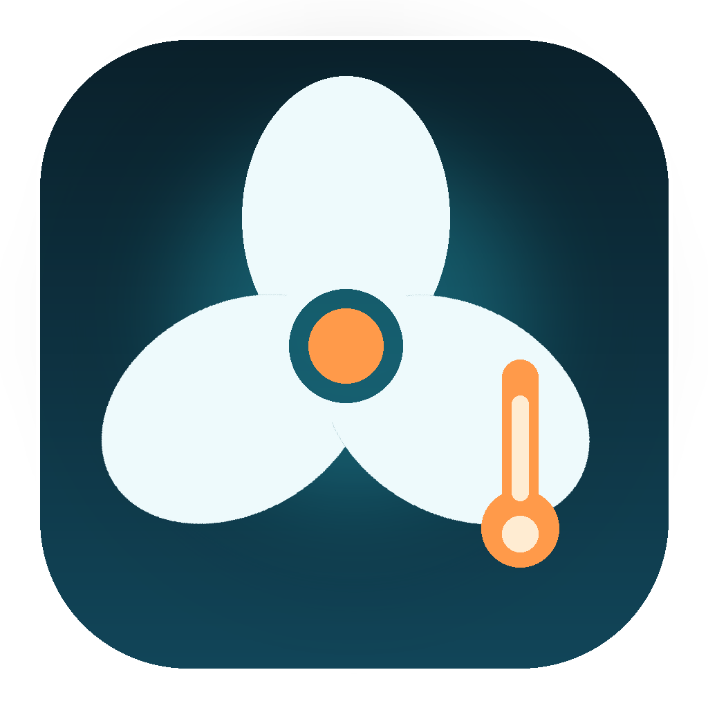

# FanLite

<p align="center"></p>

[]()
[]()
[]()

**免費、開源的 macOS 選單列溫度與風扇工具。**
適合只需要「即時溫度 + 風扇轉速 + 可調刷新頻率」的使用者，不需要訂閱，也不依賴 iStat Menus。

> 本專案與 Bjango／iStat Menus 無任何關聯。

## 功能

- 選單列顯示 CPU 最高溫度與兩顆風扇 RPM
- 控制面板：可拖拉的雙風扇 RPM 滑桿、同步兩顆風扇
- 單獨控制 Fan 0 / Fan 1，或同步控制兩顆
- 風扇模式：`auto`（macOS 控制）、`quiet`、`full`
- **80°C 自動增壓**：80°C → 4,500 RPM、88°C → 5,500 RPM、90°C → 6,000 RPM（含回退滯後）
- 刷新頻率：**5 / 10 / 30 / 60 秒**，預設 **10 秒**
- 讀取 SMC 不需要 root、不需要常駐 daemon
- 使用 MIT 授權、Apple 公證的 [`smctl`](https://github.com/leaperone/smctl) 作為底層
- 無網路功能、無遙測、無廣告

## 系統需求

- Apple Silicon Mac（M1 以後）
- macOS 14 以上
- 首次自行建置需要 Command Line Tools（`xcode-select --install`）

## 安裝 Release

1. 到 [Releases](https://github.com/boday/fanlite/releases) 下載
   `FanLite-v0.3.0-macos-arm64.dmg`。
2. 打開 DMG，把 `FanLite.app` 拖到 `Applications`。
3. 開啟 FanLite，選單列會出現 `🌡 68°C | 3000/3000 RPM`。
4. 點選單列的 FanLite →「開啟控制面板…」，即可用滑桿調整兩顆風扇。

因為 MVP 使用 ad-hoc 簽章，第一次開啟若被 Gatekeeper 阻擋，請在
「系統設定 → 隱私權與安全性」按「仍要開啟」。

## 從原始碼建置

```bash
git clone https://github.com/boday/fanlite.git
cd fanlite
./scripts/fetch-smctl.sh   # 下載並驗證 smctl v0.2.4
./scripts/build.sh --install
open "$HOME/Applications/FanLite.app"
```

建置產物在 `dist/FanLite.app`。

## 驗證

```bash
./scripts/test.sh
"$HOME/Applications/FanLite.app/Contents/MacOS/FanLite" --policy-test
"$HOME/Applications/FanLite.app/Contents/MacOS/FanLite" --once
```

預期輸出：

```text
cpu_max=68.3C fans=3000/3000RPM package=16.3W
PASS: sensor read and CLI output
```

執行日誌：

```bash
tail -f ~/Library/Logs/FanLite.log
```

每次刷新會寫入一行，可用來確認 10 秒間隔：

```text
2026-11-06T09:35:49Z cpu=68°C fans=3000/2988 package=11.6W
2026-11-06T09:35:59Z cpu=63°C fans=3023/3006 package=14.6W
```

## 風扇控制

FanLite 的風扇控制需要 `smctl` 的 root helper。首次使用前執行：

```bash
sudo "$HOME/Applications/FanLite.app/Contents/Resources/bin/smctl" daemon install
```

安裝後可用：

```bash
"$HOME/Applications/FanLite.app/Contents/Resources/bin/smctl" daemon status
"$HOME/Applications/FanLite.app/Contents/Resources/bin/smctl" fan status
```

控制面板中的操作：

- **Fan 0 / Fan 1 滑桿**：放開滑桿即套用該風扇 RPM
- **80°C 自動增壓**：勾選後依溫度自動調整；預設在有 helper 時開啟
- **同步兩顆風扇**：勾選後拖動任一滑桿會同時設定兩顆
- **系統自動**：交還 macOS 控制（可能回到 0 RPM）
- **安靜 / 全速**：使用 `smctl` 內建 profile
- **刷新頻率**：5 / 10 / 30 / 60 秒

### 安全設計

- 風扇控制由 `smctl` 的 root daemon 執行，FanLite 只呼叫已簽章的 CLI。
- `smctl` 具備熱保護：溫度過高會交還 macOS 控制。
- 不安裝 helper 時，FanLite 只讀取感測器，不可能改風扇。
- 不要同時執行 iStat Menus 或其他風扇控制器，避免兩個程式搶 SMC。

## 風扇調配建議

請見 [docs/fan-strategy.md](docs/fan-strategy.md)。重點：日常 3,000 RPM、兩顆同步；
高負載 4,500–5,000 RPM；持續 88°C 以上才全速。

## 專案結構

```text
fanlite/
├── Sources/main.swift        # AppKit 選單列程式
├── scripts/
│   ├── fetch-smctl.sh        # 下載 smctl + SHA-256 驗證
│   ├── build.sh              # 建置 .app
│   ├── package.sh            # 產生 release zip
│   └── test.sh               # 建置與讀取驗證
├── docs/fan-strategy.md     # 風扇調配建議
├── docs/releases/           # release notes
├── CHANGELOG.md
├── THIRD_PARTY_NOTICES.md
└── LICENSE
```

## 已知限制

- 目前只支援 Apple Silicon；Intel Mac 尚未驗證。
- MVP 使用 ad-hoc 簽章，尚未做 Apple notarization。
- 風扇控制需另外安裝 `smctl` root helper，這是 macOS 對 SMC 寫入的限制。
- 選單列圖示為文字，尚未提供自訂 icon。
- 尚未提供開機自動啟動；可自行把 App 加入「登入項目」。

## Roadmap

- [x] 自訂 App icon
- [ ] Apple notarization
- [ ] 登入時自動啟動選項
- [ ] 可選擇顯示的溫度感測器
- [ ] 風扇曲線編輯器
- [ ] 歷史溫度圖表
- [ ] 支援 Intel Mac 的唯讀模式

## 授權

本專案採 MIT License，見 [LICENSE](LICENSE)。
`smctl` 為獨立 MIT 專案，授權與來源見 [THIRD_PARTY_NOTICES.md](THIRD_PARTY_NOTICES.md)。
